# S7c Admin Mobile V2 — capturas accesibles y redactadas

- App code desplegado: `a267a8b104770846891ea5a93da535437f08f257`.
- Worker staging: `taco-loco-staging-20260913`, version `12b5963e-4439-4877-b5c6-fef264325590`.
- Capturas fuente: corrida Playwright Chromium autenticada del 2026-11-14, `output/playwright/s7c-final-staging-a267a8b-20261114/report.json`.
- Viewports fuente: móvil 390 px; muestras adicionales 360, 768 y 1440 px.
- Redacción: se cubrieron códigos, nombres/filas de clientes, tiempos, líneas y montos de pedidos; también el teléfono y mensaje de WhatsApp de Configuración. Capturas de Catálogo muestran únicamente contenido público del menú. La cuenta agregada de Atención se conserva como estado visual del tablero.
- Son capturas reales de staging, no maquetas. La redacción altera solamente los píxeles bajo datos variables.

## Evidencia

| Pantalla | Captura |
|---|---|
| Pedidos, cola inicial, 390 px (pedido y datos redactados) | 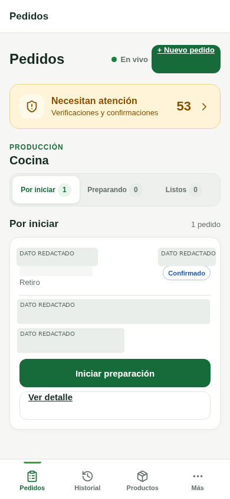 |
| Cola Por iniciar vacía, 390 px | 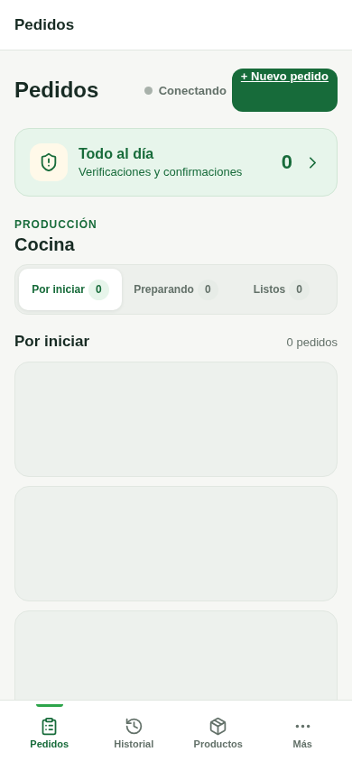 |
| Cola Preparando vacía, 390 px | 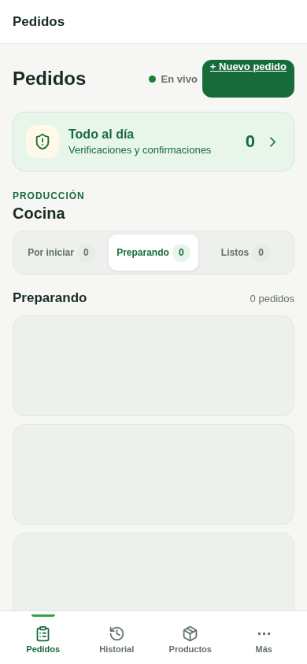 |
| Cola Listos vacía, 390 px | 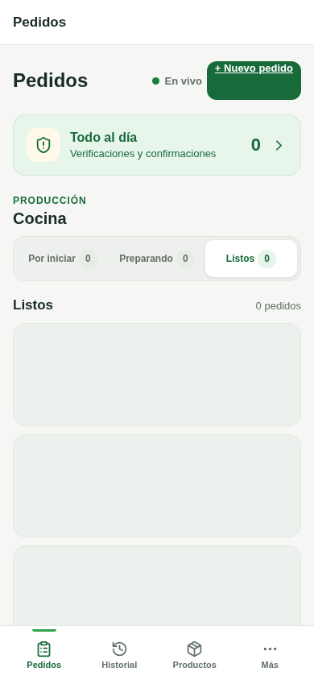 |
| Atención: encabezados de jornada actual y pendientes anteriores; campos de pedido redactados | 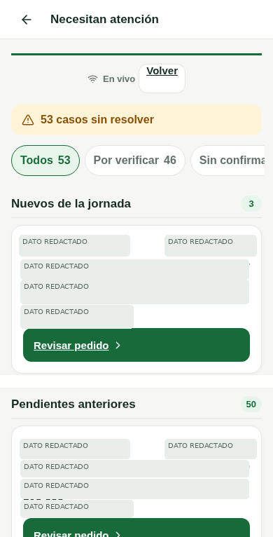 |
| Alta manual, paso 1 Productos | 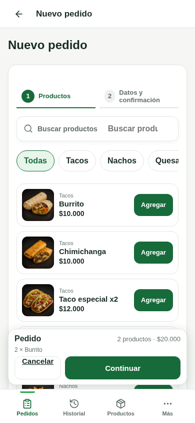 |
| Alta manual, paso 2 Datos y confirmación | 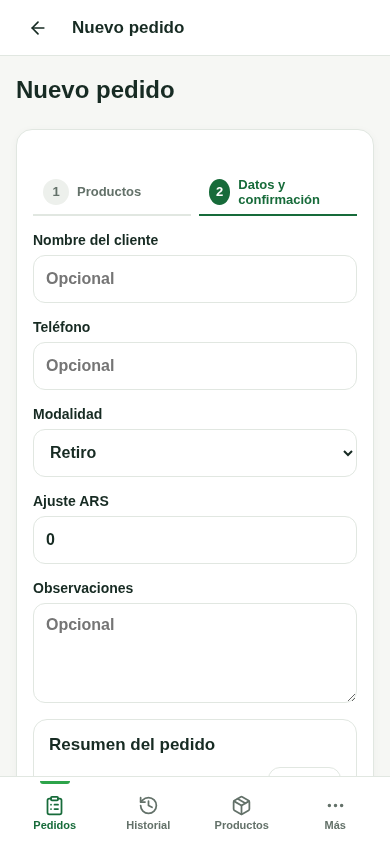 |
| Historial (datos de filas redactados) | 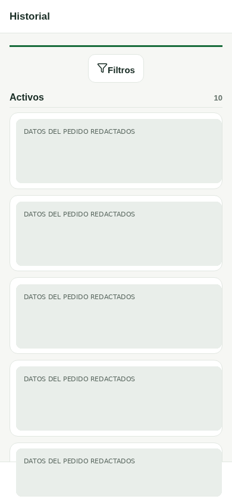 |
| Productos | 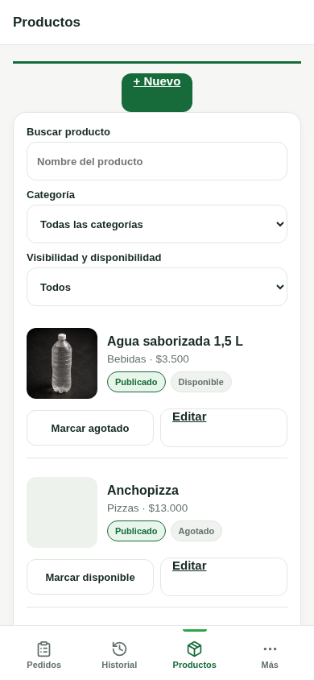 |
| Edición de producto | 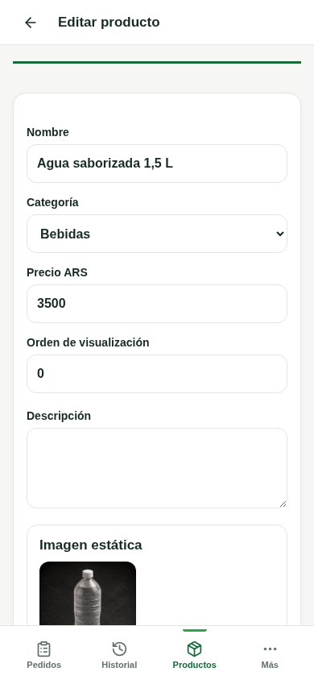 |
| Categorías | 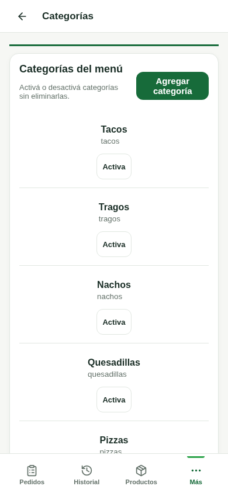 |
| Configuración (WhatsApp redactado) | 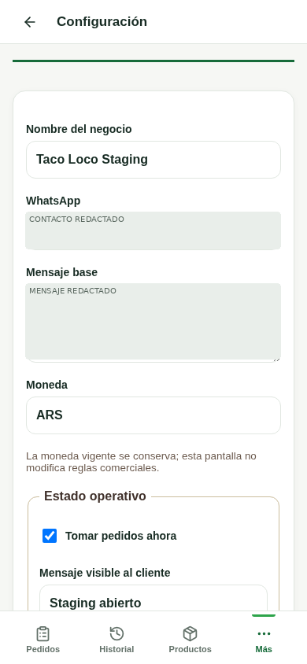 |
| Más | 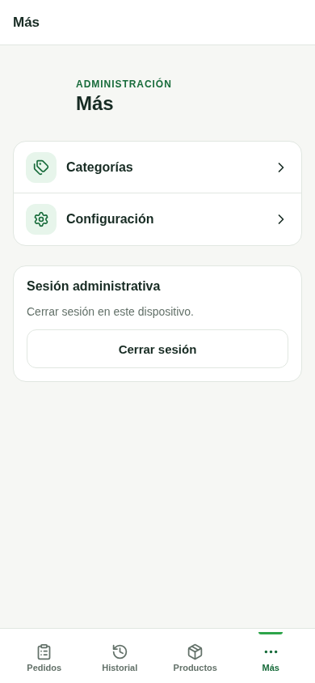 |
| 360 px | 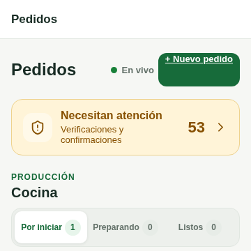 |
| 768 px | 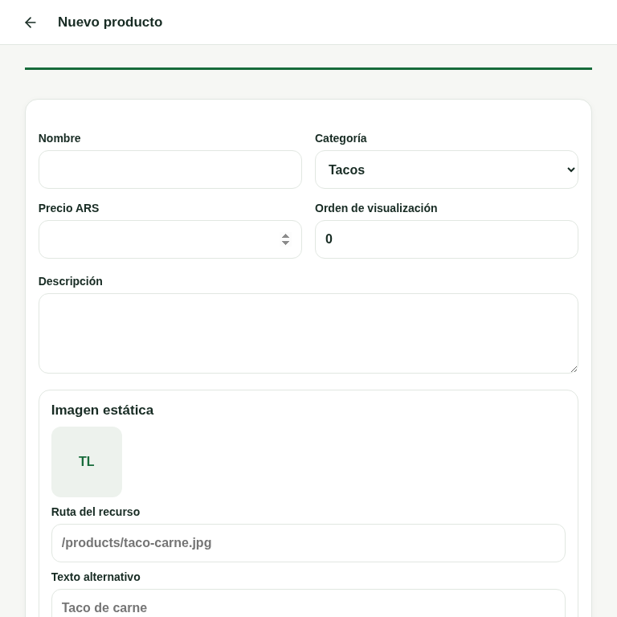 |
| 1440 px | 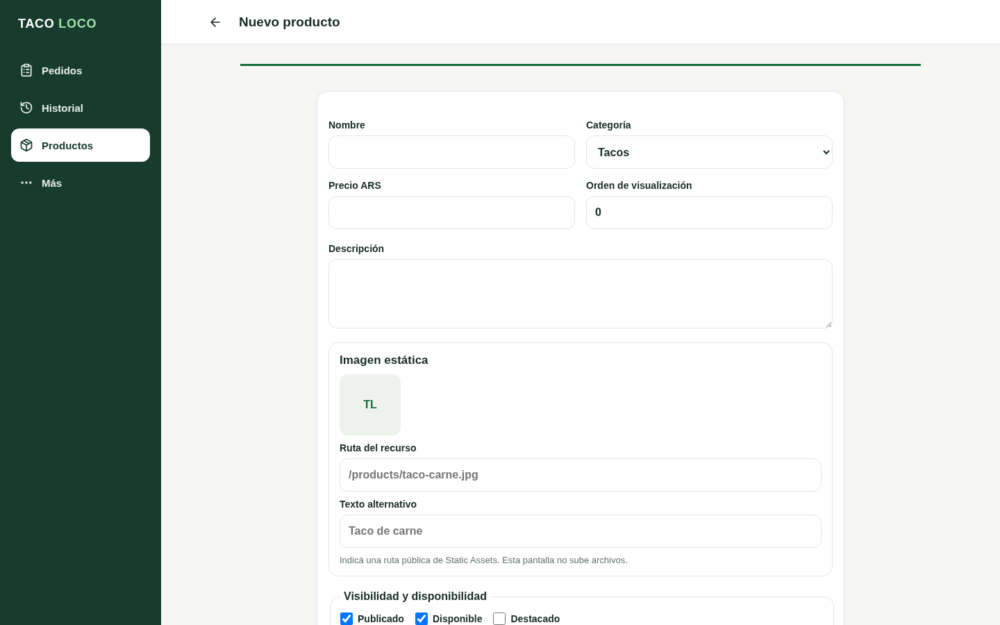 |

## Límites de evidencia

Estas capturas documentan la sesión autenticada que produjo el informe fuente; no constituyen una nueva autenticación posterior al error 500 de staging.

No se publica captura de detalle/pago: la captura de detalle de la corrida fuente quedó en skeleton de carga y no representa una pantalla válida para inspección. Tampoco se capturó el panel de modificadores. Se requiere repetir esas capturas con login estable. El detalle y confirmación de pago no se declaran visualmente aprobados por este conjunto.

Las capturas de colas muestran estados visuales con cero pedidos al momento de la toma; la tarjeta con datos redactados es evidencia aparte del tablero con un pedido. Las pruebas funcionales de transiciones están detalladas por separado en el comentario de #62 y en el reporte JSON fuente.
